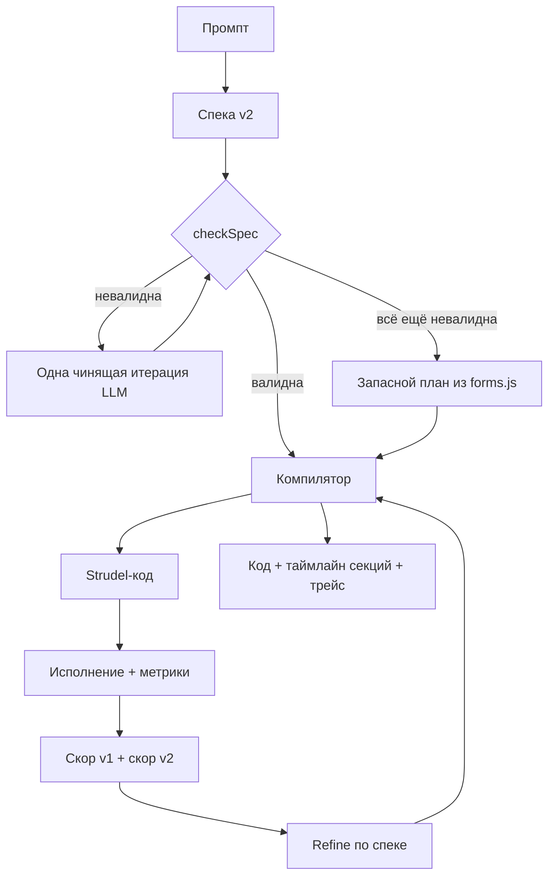

# Композиция: от промпта к развивающемуся треку

Документ описывает, как устроен структурный режим генерации: что выбирает
модель, что делает компилятор, как проверяется результат и из чего складывается
оценка.

## Зачем это нужно

Старый пайплайн превращал текст в код одним вызовом модели. Такой трек —
один длинный цикл: он может быть технически безупречным, но не развивается.
Скор оценивал одно окно и поэтому such треки не отличались от развивающихся.

Новая схема разделяет три уровня:

| Уровень | Кто решает | Что выбирается |
|---|---|---|
| Идея | LLM | гармония, форма, роли, энергия, мотив |
| Код | компилятор | синтаксис Strudel, партии, таймлайн, эффекты |
| Проверка | валидатор + движок | исполняемость, владение ладом, развитие во времени |

Модель больше не пишет код. Она выбирает из проверенной библиотеки знаний
(`server/music/knowledge/`) — прогрессии, формы, роли, рецепты. Всё, чего
нет в библиотеке, модель придумать не может: перечень ей показывается.

## Архитектура



### Шаг 1. Спека

Спека — единственный контракт между моделью и системой. Её описывает Zod-схема
`server/music/spec/schema.js`; из той же схемы получается JSON Schema для
`response_format`, так что провайдер гарантирует форму ответа.

```js
{
  meta: { style, bpm, key, seed },
  harmony: { progressionId | degrees, barsPerChord },
  form: [
    { kind, bars, energy,
      roles: { kick: { recipe, variant }, ... },
      progressionOverride?, transition? }
  ],
  motif?: { degrees, rhythm, transforms },
  automation?: [...],
  reasoning: string
}
```

Zod проверяет **форму** (типы, диапазоны). `checkSpec` (`server/music/spec/check.js`)
проверяет **содержание**: роли активны только в существующих секциях, степени
в ладу, суммарная длина 16–96 тактов, переход ведёт в существующую секцию.

### Шаг 2. Компиляция

`server/music/compiler/index.js` — чистая детерминированная функция
`compile(spec) → code`. Одна и та же спека всегда даёт один и тот же код.

Принципы сборки:

- **Партии выводятся из гармонии.** Бас, пэд, аккорды и арпеджио строятся из
  степеней прогрессии. Бас не живёт отдельной строкой мимо аккордов.
- **У каждой секции свои паттерны.** Рисунок сдвигается по секциям, а рецепт
  (`default`/`busy`/`sparse`) выводится из энергии секции, если не задан явно.
- **Таймлайн на уровне партии.** `$BASS: arrange([8, BASS_0], [16, BASS_1])` —
  микшер, mute/solo и пианороллы продолжают работать по партиям.
- **Переходы вставляются автоматически** по полю `transition`.
- **Автоматизация — только через сигналы** (`sine`/`saw`/`perlin` с
  `.slow(n).range(a, b)`), а не константами.
- **Мотив** генерируется из `motif` с трансформациями и детерминирован по зерну.

Пример вывода:

```js
// techno — 132 BPM, f:minor
// Форма: intro(8) → build(8) → drop(16) → outro(8)
// Зерно: 42

setCpm(132/4)
const key = "f:minor"

// --- константы секций ---
const BASS_0 = n("<0 5 3 4>").scale(key).slow(2).ply(2).s("sawtooth")
...

// --- партии ---
$BASS: arrange([8, BASS_0], [8, BASS_1], [16, BASS_2]).gain(0.7)._pianoroll()
```

### Шаг 3. Проверка

Валидность достигается **по построению**, а не проверкой готового текста:

1. Спека проходит Zod и `checkSpec`.
2. Код компилируется детерминированно — синтаксических ошибок быть не может.
3. Код исполняется настоящим Strudel (`server/music/strudel-runtime.mjs`) —
   на горизонте 32–96 тактов собираются реальные события.

Свободный режим (код пишет модель) идёт через тот же валидатор
(`src/core/validator.js`) — разница только в том, кто пишет код.

### Шаг 4. Оценка

Оценка двухслойная:

- **Скор v1** (`server/music/score.js`) — старые 10 критериев: темп, плотность,
  грув, тональность, диапазон, разделение регистров, аранжировка, движение
  мелодии, воздух, разнообразие партий.
- **Скор v2** (`server/music/score-v2.js`, формулы в `docs/METRICS-V2.md`) —
  новые метрики развития: кривая энергии, гармонический ритм, новизна секций,
  вариативность по партиям, разнообразие партий, автоматизация.

Итоговый балл: 60 % v1 + 40 % v2. Метрики v2 считаются по **событиям
Strudel**, а не по собственному парсеру mini-нотации: свой парсер разбирает
один-два такта и не понимает `arrange`, `stack`, `<…>/n`, `.slow`, `.mask`,
`.struct` (см. `docs/SPIKE.md` и D-001 в `docs/DECISIONS.md`).

### Шаг 5. Refine

В структурном режиме refine правит **спеку**, а не код: правка спеки
перекомпилируется, поэтому код остаётся корректным по построению.

Замечания формулируются в `server/music/compose/remarks.js` — это контракт
между метриками и моделью. Каждое замечание говорит, что не так (с точностью
до тактов и ролей) и что сделать:

- «такты 17–32: партия kick играет тот же рисунок, что и в 1–16 — задай
  другой variant»;
- «размах энергии 0.00 — секции неразличимы, опусти интро до 0.3, подними
  дроп до 0.9»;
- «нет перехода в „drop“ — трек распадается на куски».

Цикл: до 3 итераций, стоп при приросте меньше 2 баллов.

## API

### POST /api/music/compose (SSE)

Поток событий:

| Событие | Содержимое |
|---|---|
| `style` | определённый стиль трека |
| `spec` | принятая спека, число попыток модели, признак запасного плана |
| `compiled` | код, секции, партии, трейс компиляции, предупреждения |
| `scored` | оценка (v1, v2, итог) |
| `refined` | шаги улучшения, было/стало |
| `done` | финальный код, спека, оценка, секции |
| `error` | сообщение об ошибке |
| `warn` | предупреждение (спека не прошла, взята запасная) |

Тело запроса:

```json
{
  "prompt": "жёсткий техно с дропом",
  "mode": "structured",
  "style": "techno",
  "seed": 42,
  "refine": true,
  "iterations": 2
}
```

### POST /api/music/variants

Best-of-N: несколько вариантов с оценкой каждого. Углы работают на уровне
спеки — разные формы, прогрессии, наборы ролей, кривые энергии, трансформации
мотива. Похожие варианты отбрасываются по минимальному расстоянию между
спеками.

## Интерфейс

- **Переключатель режима** — «Структурный» (по умолчанию) и «Свободный».
- **Трейс пайплайна** — стиль, спека, число попыток модели, компиляция,
  оценка, шаги улучшения с текстом замечаний.
- **Таймлайн секций** — над редактором: цветные блоки (ширина = доля трека,
  насыщенность = энергия секции) и кривая энергии.
- **Список секций** — вид, длина, энергия и роли каждой секции.

Всё оформлено токенами дизайн-системы (`src/styles/tokens.css`), контраст
не ниже WCAG AA, анимации отключаются при `prefers-reduced-motion`.

## Проверка

```bash
npm test                    # тесты, включая пайплайн и замечания
npm run build               # сборка интерфейса
npm run check:secrets       # секреты не в коде
npm run check:presets       # пресеты исполняются
npm run check:knowledge     # библиотека знаний цела
npm run check:api           # whitelist публичного API Strudel
```

Eval-харнесс:

```bash
node eval/run.mjs --dry --limit 4   # проверить харнесс без модели
node eval/run.mjs                    # полный прогон A против B
node eval/analyze-ab.mjs             # разбор результатов слепого теста
```

## Известные ограничения

- **Модель решает не всё.** Спека описывает план, но не ноты: рисунок
  партий выбирает компилятор из библиотеки. Модель не может задать конкретный
  ритм — только плотность и вариант.
- **Запасной план — не музыкальный шедевр.** Если модель дважды не дала
  валидную спеку, трек собирается из формы библиотеки. Это гарантия
  работающего результата, а не качества.
- **Метрики v2 требуют исполнения Strudel** — это медленнее, чем разбор
  текста. На длинных треках измерение занимает десятки миллисекунд.
- **Скор — не истина.** Это прозрачная обратная связь для модели, а не
  объективная оценка красоты. Веса подбираются калибровкой по оценкам
  человека.
- **Слепой A/B-тест требует человека.** Автоматика даёт числа, но выбор
  «какой трек лучше» остаётся за слушателем.

## Связанные документы

- `docs/SPIKE.md` — что проверено на настоящем Strudel в фазе 0.
- `docs/DECISIONS.md` — принятые решения с обоснованием.
- `docs/METRICS-V2.md` — формулы метрик v2.
- `docs/DIVERSITY.md` — правила разнообразия: отпечаток, расстояние, углы.
- `docs/AUDIT.md` — аудит проекта.
